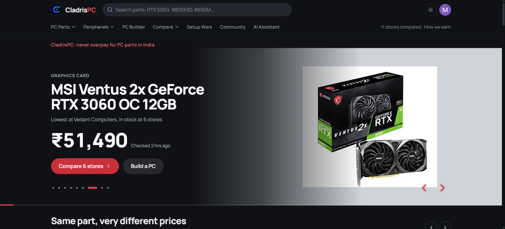
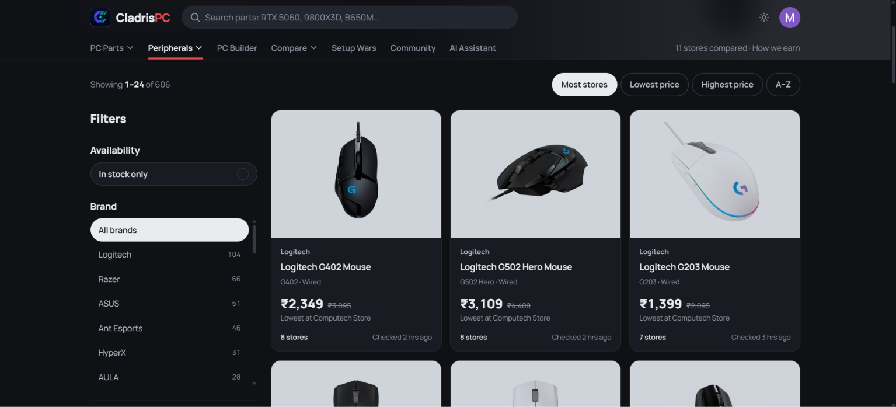
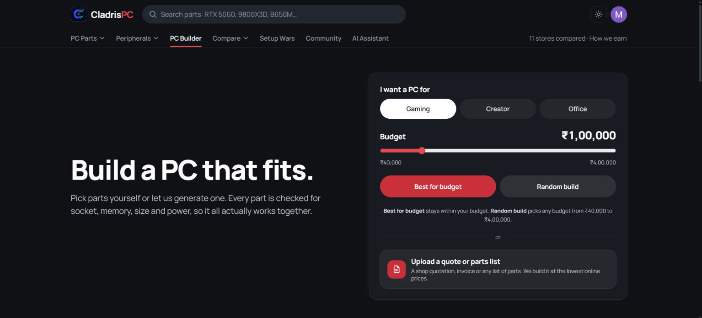
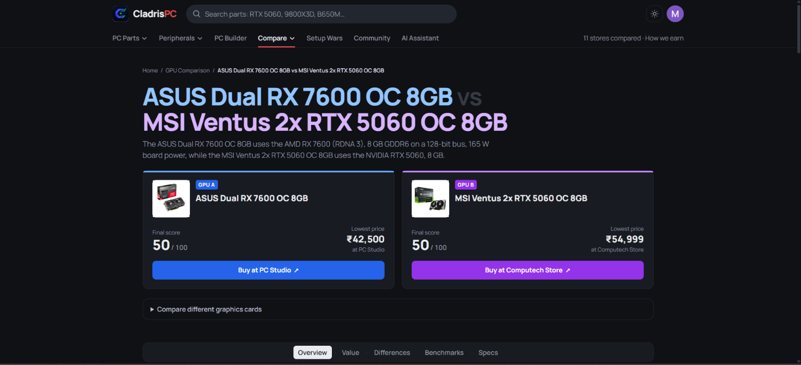
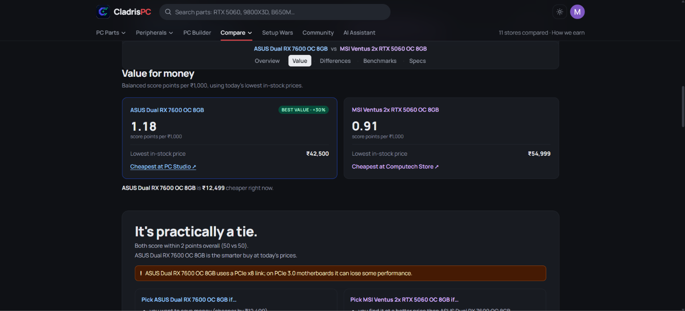
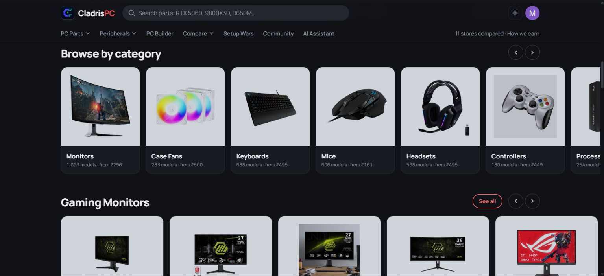
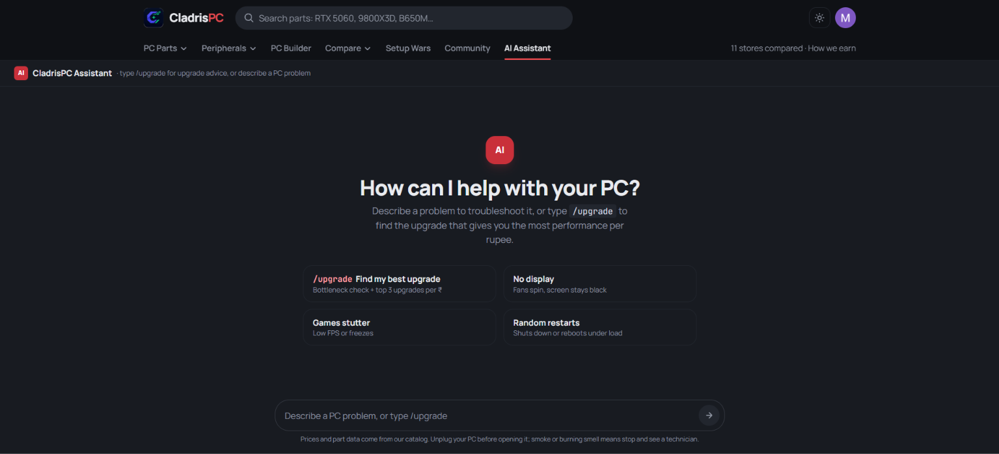

# CladrisPC: PC Parts Price Comparison & Price Tracker for India

**Build Beyond Limits.** 👉 **[www.cladrispc.com](https://www.cladrispc.com)**

CladrisPC is a free **PC parts price comparison** and **price tracking** website for India. It
compares live prices for the **exact same model** across 11 Indian stores, tracks price history,
sends price-drop alerts, and includes a **PC Builder** with compatibility checks.

> This repository is a public showcase. The source code is private.

## Why I built it

Buying PC parts in India usually means checking five store websites, calling a local shop, and
still wondering if the cheaper listing is even the same product. CladrisPC answers one question:
**where is this exact part cheapest right now?**

## Features

### PC parts price comparison across 11 Indian stores
Live prices from Vedant Computers, Computech Store, EliteHubs, MD Computers, PrimeABGB, PC Studio,
SCL Gaming, TPS Technologies, Vishal Peripherals, Amazon India and Flipkart.

- Listings are matched by **exact model** (model number, memory, edition), so "cheapest" always
  compares the same product
- Out-of-stock offers are shown but never marked cheapest
- Prices refresh several times a day and show when they were last checked

### Price tracking and price-drop alerts
Price history charts for every product, and **price-drop email alerts** for members, so you can
buy a GPU, CPU or SSD when the price falls.

### PC Builder with compatibility checks
Pick parts yourself or generate a build for your budget. Every part is checked for **socket, memory
type, form factor and PSU wattage**.

- Share a build with a link
- Copy the parts list (without prices) to get quotes from local shops
- **Quotation scanner:** upload a photo of a shop quote and compare it with online prices

### CPU, GPU and RAM comparisons
Side-by-side comparisons with benchmarks, specs and value for money at today's lowest in-stock
prices.

### All categories
CPU, graphics card (GPU), motherboard, RAM, PSU, cabinet, SSD, HDD and CPU cooler, plus
peripherals: monitors, case fans, keyboards, mice, headsets and controllers.

### Community, Setup Wars and AI Assistant
- **Community:** boards for builds, games, and PC & laptop issues
- **Setup Wars:** post your PC setup with its parts list; the best setups enter the Hall of Fame
- **AI Assistant** (Gemini) for PC troubleshooting and upgrade advice

## Tech stack

- **Next.js**, hosted on **Vercel**
- **PostgreSQL** on **Neon**
- **Python** scrapers for price collection

## Useful links

- 🖥️ [CladrisPC home](https://www.cladrispc.com)
- 🛠️ [PC Builder](https://www.cladrispc.com/build)
- 🎮 [GPU comparison](https://www.cladrispc.com/compare/gpu)
- 💬 [Community](https://www.cladrispc.com/community)
- 🏆 [Setup Wars](https://www.cladrispc.com/setups)
- ℹ️ [About](https://www.cladrispc.com/about)

## How it's free

CladrisPC is free to use. Some store links are affiliate links, which pay for hosting
([affiliate disclosure](https://www.cladrispc.com/affiliate-disclosure)). Stores do not endorse
CladrisPC.

## Feedback and bugs

Found a wrong price or a broken page? [Report a bug](https://www.cladrispc.com/community/new?board=other&tag=bug)
or email support@cladrispc.com. Store owners who want their store removed can email the same
address.
